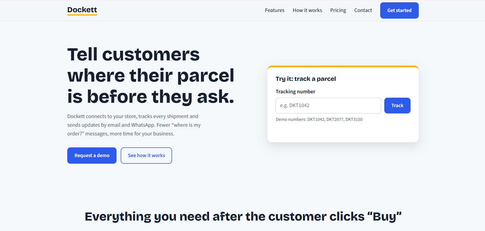
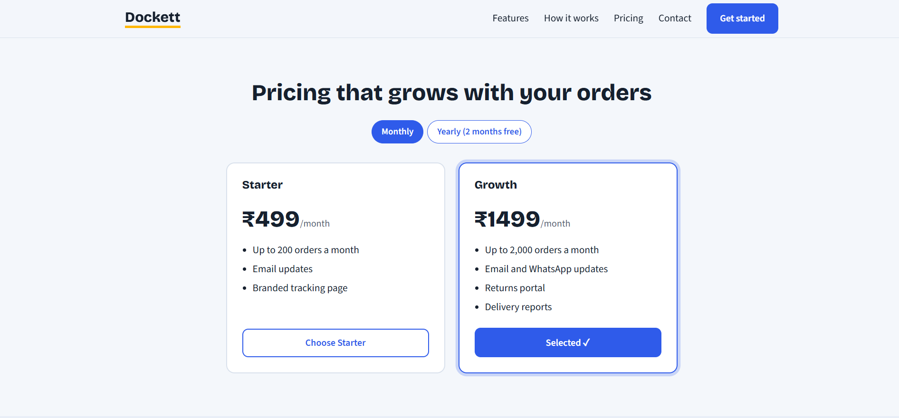
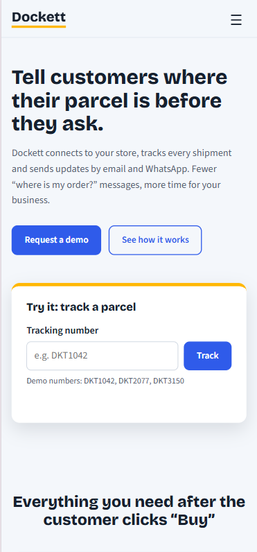

# Dockett – SaaS Landing Page

Landing page for **Dockett**, an invented SaaS that tracks shipments and handles returns for small online stores.    
Live link: https://ubiquitous-sfogliatella-4179b9.netlify.app/

## Design choices
I made up a product called Dockett, a shipment-tracking tool for small online stores, so the page could display real content. I went with a cool blue-grey background and an amber accent.
For the hero, I skipped the usual stock illustration and built a small tracking demo instead. You can type a sample tracking number and see a status timeline, which shows off JavaScript and gives visitors something to try.
I used CSS Grid so the cards stack neatly on smaller screens, and the navbar turns into a menu button on mobile.
The pricing cards are clickable: choosing one highlights it and deselects the other. The demo form checks the name and email and shows a clear error or success message.

The trickiest parts were making the layout work on both phone and desktop and getting the plan selection to behave properly. I fixed both by checking the page at different screen sizes and tweaking things until they worked.

## Run locally
No build step. Clone the repository and open `index.html` in a browser.

## Technologies
HTML5, CSS3 (Grid, Flexbox, custom properties) and vanilla JavaScript.

## Features
- Sticky navbar with smooth-scroll links and a mobile menu
- Hero with a working tracking demo 
- Features, How it works, Pricing (monthly/yearly toggle), Contact form, Footer
- Demo form with validation and a success message

## Files
`index.html` structure · 
`style.css` styling and responsive rules · 
`script.js` interactions

## Screenshots

**Desktop View**

**Mobile View**

